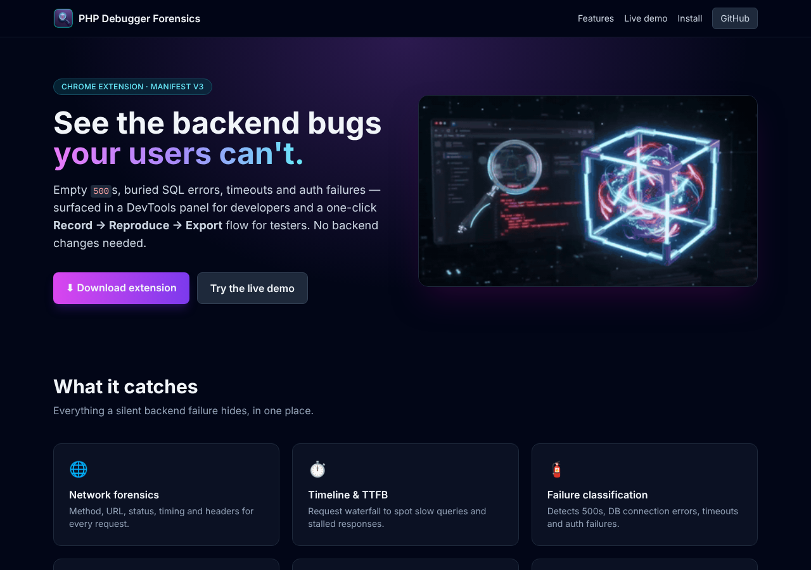
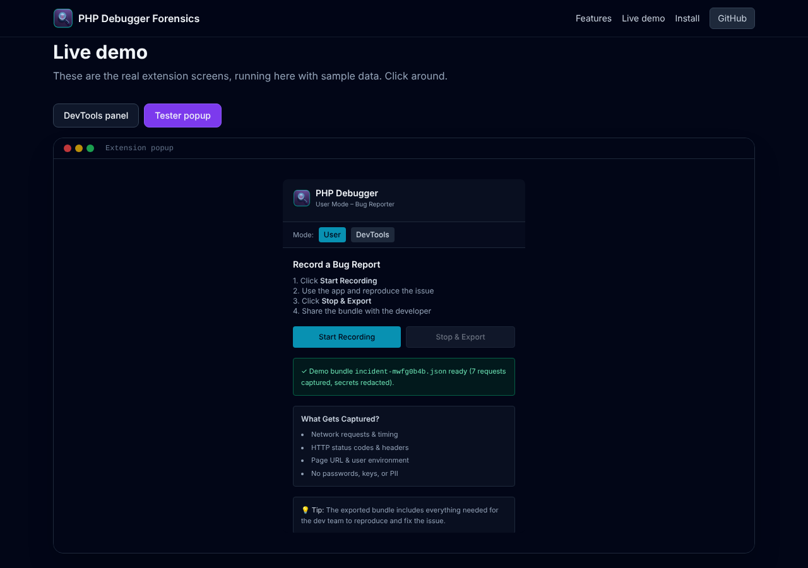
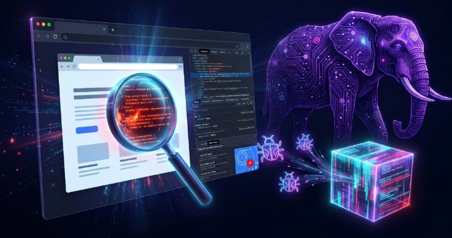
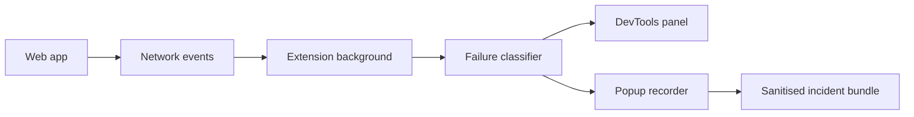

<div align="center">


# 🐞 PHP Debugger Forensics

### Chrome extension that makes silent PHP/SQL backend failures visible — DevTools forensics and tester-friendly bug bundles

   

[](LICENSE)    

[](https://codespaces.new/shiroonigami23-ui/PhpDebugger?quickstart=1) [](https://github.com/shiroonigami23-ui/PhpDebugger/archive/refs/heads/main.zip)

[**🚀 Live Demo**](https://php-debugger-rj1n.vercel.app) · [**Overview**](#-overview) · [**Features**](#-features) · [**Architecture**](#-architecture) · [**Getting Started**](#-getting-started) · [**Roadmap**](#-roadmap)

</div>

---

<p align="center"> </p>

## 📸 Preview

<p align="center"></p>

## 📖 Overview

**PHP Debugger Forensics** is a Chrome extension for the backend bugs users can't see: `500` errors with empty bodies, database connection failures, buried SQL errors, timeouts and auth issues. Developers get a **DevTools panel** with real-time **network forensics**, **failure-pattern classification**, timing/TTFB analysis and **correlation-ID** lookup; non-technical testers get a simple **Record → Reproduce → Export** popup that produces a clean, sanitised incident bundle — all **without modifying your backend**.

### ✨ Highlights

- **Dual-mode UI** — DevTools panel + tester popup
- **Failure classification** for PHP/SQL patterns
- **Sanitised exports** safe to attach to tickets

## 🧩 Features

| Feature | What it does |
|---|---|
| **Network forensics** | Method, URL, status, timing, headers |
| **Timeline** | Request waterfall and TTFB analysis |
| **Payload inspection** | Sanitised response bodies |
| **Failure classification** | Detects 500s, DB errors, timeouts, auth failures |
| **Correlation IDs** | Match front-end failures to server logs |
| **Recorder** | Record → Reproduce → Export for testers |

## 📄 Technical Whitepaper

**[Read the whitepaper (PDF)](docs/WHITEPAPER.pdf)** · [Markdown version](docs/WHITEPAPER.md)

Why I built it, the journey so far, the silent-failure problem, MV3 architecture, failure classification, privacy design and roadmap.

## 🛠 Tech Stack

| Layer | Technology |
|---|---|
| Extension | Manifest V3, declarative rules |
| UI | Nuxt, TypeScript, Tailwind |
| CI | GitHub Actions |

## 🏗 Architecture




➡️ Full design notes, data flow and design decisions: **[docs/ARCHITECTURE.md](docs/ARCHITECTURE.md)**

## 📁 Project Structure

```text
PhpDebugger/
├── manifest.json · rules.json
├── src/            # Nuxt app (DevTools panel & popup)
└── icons/
```

## 🚀 Getting Started

### 1. Get the code

Pick whichever method suits you:

| Method | Command |
|---|---|
| **HTTPS** | `git clone https://github.com/shiroonigami23-ui/PhpDebugger.git` |
| **SSH** | `git clone git@github.com:shiroonigami23-ui/PhpDebugger.git` |
| **GitHub CLI** | `gh repo clone shiroonigami23-ui/PhpDebugger` |
| **ZIP** | [Download](https://github.com/shiroonigami23-ui/PhpDebugger/archive/refs/heads/main.zip) and extract |
| **Codespaces** | [Open in browser](https://codespaces.new/shiroonigami23-ui/PhpDebugger?quickstart=1) — zero local setup, dev container preconfigured |

> 🔑 **Using SSH for the first time?** Generate a key with `ssh-keygen -t ed25519 -C "you@example.com"`, add the `.pub` contents at **GitHub → Settings → SSH and GPG keys**, then test with `ssh -T git@github.com`.

### 2. Install & set up

```bash
cd PhpDebugger
cd src && npm install && npm run build
```

### 3. Run

Load the built extension via `chrome://extensions` → **Load unpacked**. Open DevTools → **PHP Debugger** panel.

## 🗺 Roadmap

**v1 (done)**

- [x] DevTools panel, popup recorder, classification, export

**v1.1**

- [ ] Laravel / WordPress specific detectors
- [ ] HAR import
- [ ] Companion PHP middleware that adds correlation IDs

**v2.0**

- [ ] Firefox build
- [ ] Team sharing of incident bundles

➡️ Detailed plan, milestones and long-term vision: **[docs/ROADMAP.md](docs/ROADMAP.md)**

## 🤝 Contributing

Contributions, issues and feature requests are welcome!

1. Fork the repository
2. Create a feature branch: `git checkout -b feature/amazing-feature`
3. Commit your changes: `git commit -m "feat: add amazing feature"`
4. Push the branch: `git push origin feature/amazing-feature`
5. Open a Pull Request against `main`

Check the [issues page](https://github.com/shiroonigami23-ui/PhpDebugger/issues) and the [roadmap](docs/ROADMAP.md) for ideas on where to help.

## 📜 Changelog

See [CHANGELOG.md](CHANGELOG.md) for the release history.

## 📄 License

Distributed under the **MIT** license. See [LICENSE](LICENSE) for details.

## 👤 Author

**Aryan Singh Chandel** (Shiro)

[](https://github.com/shiroonigami23-ui)

<div align="center">

⭐ **If you find this project useful, consider giving it a star!** ⭐

</div>
