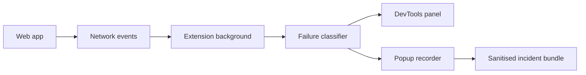

# 🏗 Architecture — PHP Debugger Forensics

> Part of [PhpDebugger](https://github.com/shiroonigami23-ui/PhpDebugger). Back to the [README](../README.md).

## 1. System Overview

The extension observes network traffic, classifies failures and surfaces them in two UIs tailored to developers and testers.

## 2. Components

| Component | Location | Responsibility |
|---|---|---|
| **Manifest** | `manifest.json` | Permissions, panels |
| **UI** | `src/` | Panel and popup |

## 3. Data / Control Flow

1. Capture requests.
2. Classify failures.
3. Inspect or export.

## 4. Key Design Decisions

| Decision | Rationale |
|---|---|
| No backend changes | Works on any site |

## 5. Known Limitations

- Chromium only

---
*Last updated: 2026-11-13*
