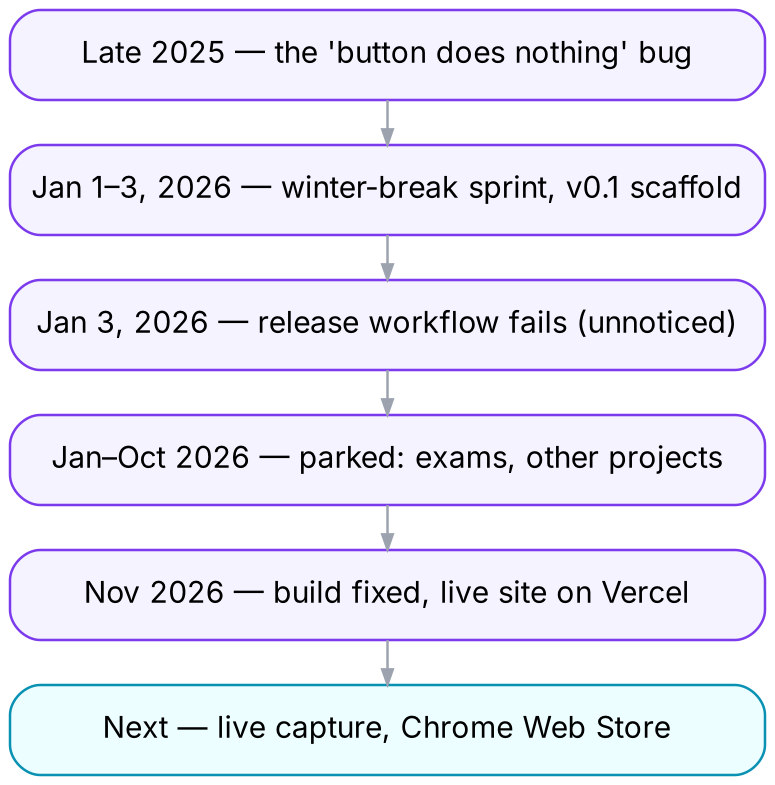
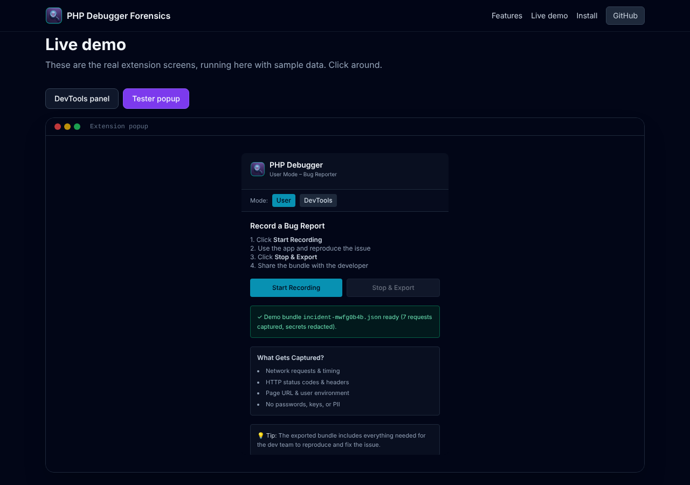
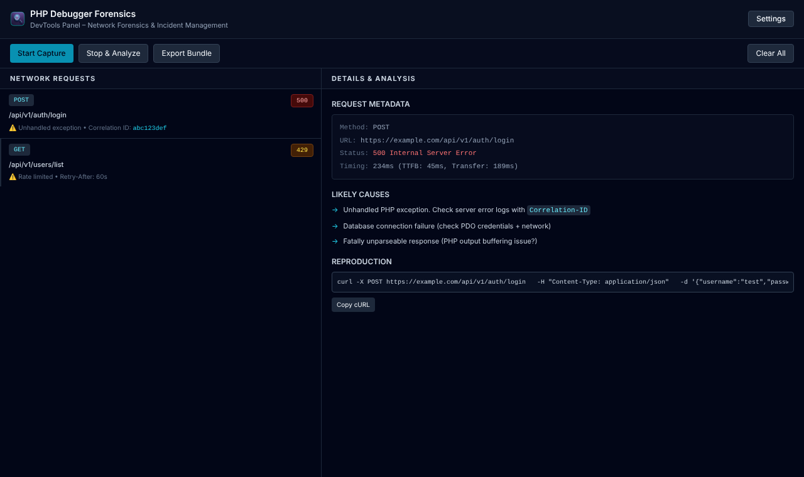
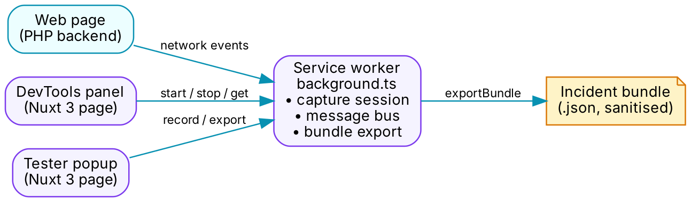
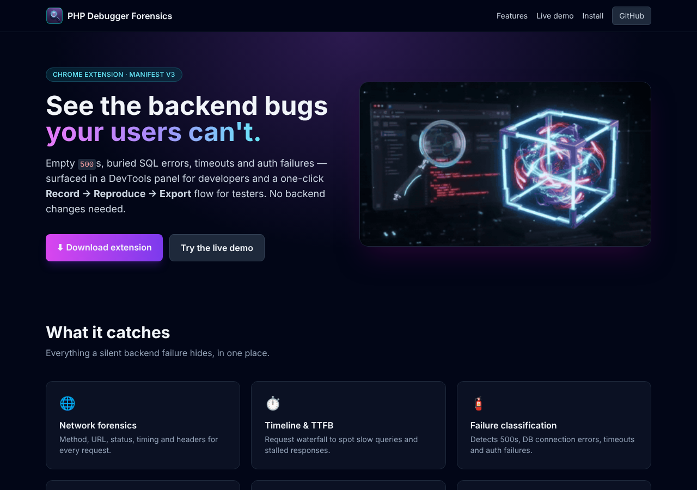
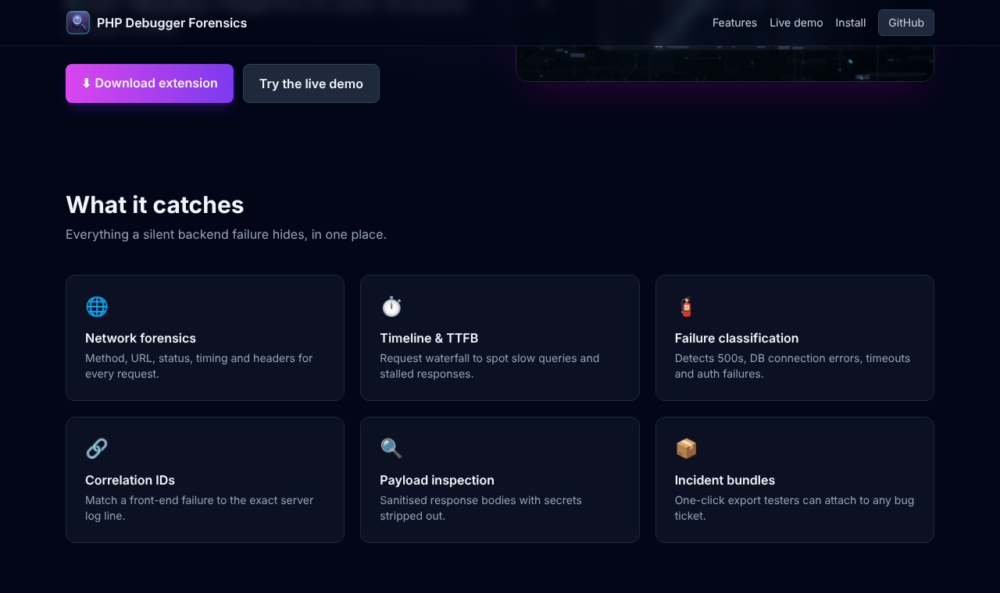
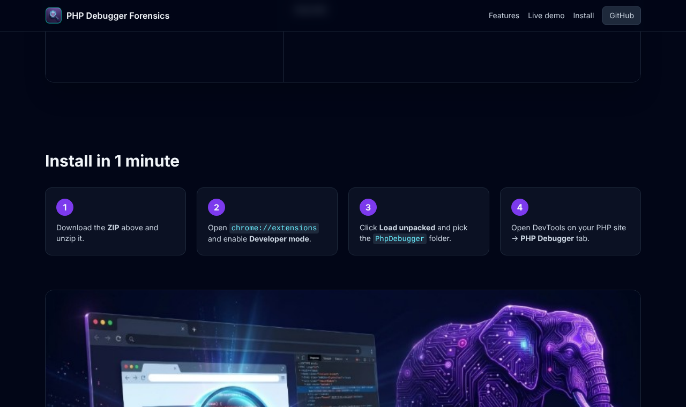

# Where This Starts

## The bug that wasn't there

Every project I've built has a "why", but most of them are boring when you say them out loud. "I wanted to learn X." "There was an assignment." This one is different. It came out of a very specific, very annoying feeling: the feeling of being told something is broken while staring at a screen where everything looks perfectly fine.

It was late 2025, somewhere in the middle of my fifth semester of B.Tech CSE at RJIT. I was helping out on a small PHP + MySQL project, the kind of thing every CS student ends up building at some point: a login page, a dashboard, a couple of forms that write to a database, and a lot of `include 'config.php';` holding everything together. A friend was testing it for me on his laptop, and the message I got was simply:

> "Bhai, the submit button isn't doing anything."

So I opened it. Clicked submit. It worked. Data saved. Redirect happened. Green message. Everything.

I sent back the classic developer reply: "Works on my machine try again?" He tried again. Still nothing. I asked for a screenshot. The screenshot showed a form with the button pressed. That's it. No error, no red text, no popup. Just a page that had quietly given up.

It took us almost an hour on a call to figure it out. His session had expired in a weird way, so the backend threw an exception while validating the CSRF token. The PHP error handler caught it, logged nothing useful because logging wasn't set up properly on that server, and returned an **empty `500` response**. The front end was written by someone (okay, by me) who never handled the error case, so from the user's side the button simply did nothing.

The fix took two minutes. Finding it took an hour, and most of that hour was me saying things like:

- "Can you press F12?"
- "No, the other tab. Network."
- "Okay now click the button again. Do you see anything red?"
- "Click on that red line. No, the one that says 500. Now go to Response. What does it say?"
- "It says nothing? Okay, that's actually useful."

That last line stuck with me. **"It says nothing" was the most useful piece of information in the whole conversation**, and I only got it after walking a non-developer step by step through a tool that was never designed for him.

## The pattern I started noticing

Once I noticed it, I saw it everywhere. Backend failures in PHP apps (and honestly in most web apps) mostly come in a few flavours:

| What the user says | What actually happened |
|---|---|
| "Button does nothing" | `500` with an empty body; the JS never shows an error |
| "It loads forever then breaks" | Database connection timeout (PDO waiting on a dead MySQL host) |
| "It logged me out randomly" | `401` / `419` because the session or CSRF token expired |
| "Some data is just missing" | A SQL error caught in a `try/catch` and turned into an empty array |
| "It worked yesterday" | Rate limiting, a changed config, or a cold server |

In every case, **the evidence exists for a few seconds inside the user's browser** — in the network traffic, at the exact moment of failure. Then they close the tab and it's gone. The developer (me) gets a vague sentence and has to reconstruct a crime scene from memory.

I remember thinking: browsers already record all of this. Chrome DevTools sees every request, every status code, every header. The problem isn't that the data doesn't exist. The problem is that:

1. The person who sees the bug can't use DevTools.
2. The person who can use DevTools can't see the bug.

That gap is basically the entire reason this project exists.

## Why not just "add logging"?

The obvious senior-dev answer is "just add proper logging on the server". And yes, that's correct. If I controlled every server perfectly, with Sentry or a good logging pipeline, I'd catch most of this from the backend side.

But the reality for students and small projects is different:

- Half the PHP projects we touch are **legacy** — someone else's code, shared hosting, no SSH, no way to install agents.
- Free hosting often **doesn't even give you error logs**, or gives them in a format that's painful to read.
- College projects get deployed once, demoed once, and then live on some free tier where nobody is watching.
- Even with good logs, you still need to know **which request** the user is talking about. "Around 4 pm" is not a query.

So I didn't want something that required changing the backend. I wanted something that sat in the browser, where the failure is actually visible, and turned that moment into evidence.

That idea became **PHP Debugger Forensics**. The name is a bit dramatic, I know. But that's honestly how debugging this stuff feels — like forensic work. You're not fixing a bug yet. You're trying to prove what happened.

## What this document is

This isn't a normal README, and it's not a research paper either. It's the story of building this thing: where I was when I started, what I tried, what broke (a lot), how I fixed it, what the code actually does, and where I want to take it next.

I'm writing it partly for anyone who finds the repo and wants to understand *why* it looks the way it does, and partly for myself, because when I look back at projects from even a year ago I've already forgotten half the decisions. Writing it down is how I keep the lessons.

{width=62%}


# Who I Was When I Started

## Starting point, honestly

I think it's important to be honest about the starting point, because projects always look smarter in hindsight than they felt while building them.

When I started thinking about this, I was in the second half of my third year of B.Tech CSE. My comfort zone looked roughly like this:

- **Comfortable:** JavaScript, HTML/CSS, Python, basic PHP + MySQL, Git, building small full-stack things that work.
- **Kinda comfortable:** Vue, TypeScript (I could read it, but I wrote it like JavaScript with extra steps), Tailwind.
- **Never touched:** browser extension development. Not even a "hello world" extension.
- **Scared of:** Chrome's extension docs, which are huge and change every year. Manifest V2 vs V3 discussions online made it sound like the entire ecosystem was in a civil war.

I had used extensions my whole life, obviously. But I had zero idea how they were structured internally. I didn't know what a service worker was in an extension context, I didn't know that popups die the moment you click away, and I definitely didn't know how DevTools panels were built. I just assumed it was "some HTML and some JS", and that assumption turned out to be about 40% correct.

## The constraints I was working with

A lot of what I built was shaped less by "best practice" and more by my actual situation:

**Time.** Semester life isn't a hackathon. Between classes, labs, assignments, internal exams and everything else, I mostly had nights and breaks. The real coding happened in a short, intense **winter-break sprint at the very start of January 2026**, which you can literally see in the commit history: almost everything landed between January 1st and 3rd.

**Hardware.** I don't have some beast of a machine. Running a Nuxt dev server, Chrome with DevTools open, VS Code and a local PHP + MySQL stack at the same time made my laptop sound like it was preparing for takeoff. I learned to close tabs I didn't need very quickly.

**Internet.** College and home Wi-Fi aren't always reliable. `npm install` failing halfway because the connection dropped was a regular thing, not an edge case. (That actually comes back later in this story in a different way.)

**No mentor for this specific thing.** I had seniors and friends I could ask about general coding, but nobody around me had built a Chrome extension with a DevTools panel. So this one was mostly me, the official docs, a lot of GitHub issues, and trial and error.

## What I wanted to prove to myself

Every project has a "public" goal and a private one. The public goal here was obvious: build a tool that makes backend failures visible.

The private goal was this: **I wanted to build something that felt like a real product, not a college project.** Something with:

- a clear problem statement,
- two different types of users (developers *and* non-technical testers),
- a real UI that doesn't look like a 2009 admin panel,
- automated releases,
- and documentation that someone else could actually follow.

Up to that point, most of my projects were "it works if you run it the way I run it". I wanted to break that habit. This project is where I first started seriously thinking about things like release pipelines, packaging and "what happens when someone who isn't me tries to install this?"

Spoiler: I didn't get all of that right the first time. But I got further than I would have if I hadn't tried.

## The mindset going in

There's a mistake I used to make all the time: I'd start a project by building the most exciting part first and leave the boring infrastructure for "later", which usually means never.

For this one I made a rule for myself: **structure first, features second.** Before writing any capture logic, I wanted the skeleton right:

1. How does the extension load?
2. Where does state live?
3. How do the different parts talk to each other?
4. How does it get built and released?

It sounds boring, but this decision is the reason the project could be revived ten months later without a full rewrite. The skeleton held. The parts around it broke, but the core shape was right. More on that later.


# Figuring Out the Problem Before Writing Code

## Looking at what already exists

Before building anything I did the responsible thing and checked whether this already existed. If someone had already solved it properly, I'd rather use their tool than reinvent it.

Here's roughly what I found and why none of it fit exactly:

| Option | What it's good at | Why it didn't solve *my* problem |
|---|---|---|
| **Chrome DevTools → Network tab** | Sees everything: requests, headers, timing, bodies | Built for developers; a tester won't use it, and nothing is saved unless you export |
| **HAR export** | Full recording of network activity | Huge, unreadable files, and they contain cookies, tokens and everything else, so sharing one in a ticket is a security risk |
| **Error tracking SaaS (Sentry etc.)** | Great backend and frontend error reports | Needs SDK integration in the app; not possible on legacy or shared hosting projects |
| **Server logs** | The "real" truth | Often missing or inaccessible on cheap hosting, and hard to match to one user's click |
| **Screen recording tools** | Shows what the user saw | Shows the *symptom*, not the *cause*; a video of a button doing nothing is not evidence |

The HAR export thing was a real eye-opener. I tried it once and got a file of several megabytes for a simple page. When I opened it, it had **session cookies sitting there in plain text**. If a tester attached that to a public GitHub issue, they'd basically be handing over their login. That's when "privacy" moved from a nice-to-have to a core requirement.

## Talking to the "users"

I didn't run a formal user study (I'm a student, not a UX lab), but I did something simple. I asked a few friends who had tested projects for me or for others: *"When something breaks, what do you actually do?"*

The answers were honestly hilarious and also very educational:

- "I refresh like 5 times."
- "I send a screenshot."
- "I tell you it's broken and you fix it." (Thanks bro.)
- "I try on my phone to see if it's the laptop."
- Nobody said "I open DevTools." Not a single person.

That confirmed the dual-audience idea. Developers need depth. Testers need **two buttons and zero thinking**:

1. *Start recording.*
2. *Stop and export.*

Anything more complex than that, and they just won't use it.

## Writing the problem down properly

I wrote the problem statement in a notes file before writing any code, and it became the "north star" for every decision:

> **Make silent backend failures visible from the browser, without changing the backend, in a form that is safe to share and useful to the developer who has to fix it.**

Every feature since then gets checked against that sentence:

- *Without changing the backend* rules out anything that needs a PHP library installed.
- *Safe to share* means sanitising bundles before export, always.
- *Useful to the developer* means classifying failures, not just dumping raw data.
- *Visible from the browser* means the extension is the product, not a side tool.

## Deciding on the platform

Chrome extension vs. something else was an easy decision:

- Testers already use Chrome (or Chromium-based browsers like Edge and Brave).
- Extensions can see network activity that normal web pages can't.
- DevTools has an official API for adding custom panels, so I could put the developer view exactly where developers already are.

The harder question was **Manifest V2 or V3**. A lot of older tutorials were MV2. But Chrome had been phasing MV2 out, and building something new on a dying platform felt stupid. So I went with **MV3** from day one, even though it meant fewer tutorials and some confusing restrictions (I'll come back to those).

## Choosing the UI stack

For the actual screens (the popup and the DevTools panel), I had a few options:

- **Plain HTML + JS:** simple, but it gets messy fast once you have state, lists and tabs.
- **React:** I knew it, but it felt heavy for this.
- **Vue / Nuxt:** I liked Vue's template style, Nuxt gave me routing and a build setup for free, and Tailwind would make the UI look decent without writing much CSS.

I went with **Nuxt 3 + Vue 3 + Tailwind + TypeScript (strict)**. Looking back, Nuxt is slightly overkill for an extension, because it's designed for full websites. But that "overkill" actually saved me later: when I wanted to deploy a public demo site, the same codebase could generate a static website almost for free. Sometimes the "wrong" choice turns out right for reasons you didn't plan.

One more decision I made early: **`ssr: false`**. Extensions don't have a server, so server-side rendering makes no sense. Everything runs as a single-page app inside the extension pages.


# Designing the Dual-Mode Idea

## One tool, two very different people

The most important design decision in the whole project is that there are **two modes for two different humans**:

| | Developer mode | Tester mode |
|---|---|---|
| **Who** | Me, or anyone who will fix the bug | A friend, a QA person, a client, a user |
| **Where** | Inside Chrome DevTools, as its own panel | The extension popup (click the icon in the toolbar) |
| **What they want** | Every detail: status, headers, timing, correlation IDs, patterns | "Record. Reproduce. Send. Done." |
| **Tolerance for complexity** | High | Basically zero |
| **Output** | Understanding of the failure | A file they can attach to a ticket or WhatsApp |

At first I tried designing one UI that served both, and it was a disaster on paper. Every screen was either too complex for testers or too shallow for developers. Splitting them was the moment the design clicked.

## Sketching the tester flow

I literally sketched this in a notebook first. The tester flow has four steps, and I wanted the popup to make them impossible to get wrong:

1. **Click "Start Recording".** The button changes state, and a timer shows it's recording.
2. **Use the app normally and reproduce the issue.** No instructions needed; just do the thing that broke.
3. **Click "Stop & Export".** Recording stops and a bundle is created.
4. **Send the bundle to the developer.** The popup tells you it's ready and what's inside.

Below the buttons there's a small "What gets captured?" box. That box is there for trust. If I'm asking someone to install an extension that watches their network traffic, the least I can do is tell them clearly what it captures and what it doesn't (no passwords, no keys, no personal data).

{width=88%}

## Sketching the developer panel

The developer panel was designed like a two-pane email client:

- **Left:** a list of network requests, with method, path, status badge and a one-line summary ("Unhandled exception · Correlation ID: abc123def").
- **Right:** the selected request in detail: timing, headers, a classification of what probably went wrong, and suggested next steps.
- **Top:** controls (Start Capture, Stop & Analyze, Export Bundle, Clear All).

The status badges are colour-coded on purpose: red for `5xx`, yellow for `4xx` like rate limits, and so on. When you have 80 requests on screen, colour is the fastest way to spot the problem.

{width=100%}

The "suggested next steps" part was something I added after thinking about my own debugging habits. When I see a PDO connection failure, the first three things I check are always the same: credentials, whether the DB host is reachable, and whether the connection limit is hit. So why not put those right next to the error? It turns the panel from "here's data" into "here's what to do".

## The architecture in one picture

MV3 extensions are made of separate pieces that don't share memory. They talk by sending messages. Once I understood that, the architecture almost designed itself:

{width=100%}

- The **service worker** (`background.ts`) owns the capture session. It is the single source of truth.
- The **DevTools panel** and the **popup** are just views. They ask the worker to start, stop, fetch or export.
- The **incident bundle** is what comes out the other end: a JSON file with events, environment info and correlation IDs.

Why put state in the worker and not the UI? Because in MV3:

- the popup is **destroyed the instant it closes** (click anywhere else and it's gone, including all its variables);
- the DevTools panel only lives **while DevTools is open**;
- the service worker can be **stopped by Chrome when idle**, but it's still the most stable shared place.

If the popup held the recording, the tester would lose everything just by clicking the page to reproduce the bug, which is literally the thing they need to do. That would have been a hilarious way to fail.

## Keeping the data model flat

I spent more time on the event shape than I expected. The temptation is to store everything: every header, full bodies, timing breakdowns. But big nested objects make bundles hard to read, hard to diff and dangerous to share.

So the event model is small and flat:

```ts
interface CaptureEvent {
  type: 'request' | 'response' | 'error'
  timestamp: number
  url: string
  method: string
  status?: number
  headers?: Record<string, string>
  correlationId?: string
}
```

A bundle is just a list of these plus some environment info. You can open it in any text editor and understand it. You can diff two bundles. You can grep it. That's the level of simplicity I wanted.


# The Winter-Break Sprint

## January 1st, 2026

Most people start the new year with resolutions. I started it with `npx nuxi init`.

Winter break is the only time in the semester when I get multiple full days with no classes, no labs and no deadlines breathing down my neck. I'd been sitting on this idea (and a couple of others) for weeks, so I planned the break around actually building them. Looking at my GitHub history from those first days of January, it's honestly a bit chaotic: PHP Debugger, a media extension and a page-cleaner extension, all pushed within about three days. That was the "extension era", and this project was one of its main characters.

## Day 1: fighting the skeleton

The first day was not glamorous. It was almost entirely about getting a Nuxt project to produce something Chrome would accept as an extension.

Here's the thing nobody tells you: **Nuxt wants to be a website, and Chrome wants an extension.** They don't naturally agree on anything:

- Nuxt outputs `index.html` and route folders. Chrome wants specific files at specific paths declared in `manifest.json`.
- Nuxt loves loading scripts dynamically. MV3's Content Security Policy is very strict about what scripts may run, and where they come from.
- Nuxt's dev server is great for UI work, but you can't load a dev server URL as an extension page.

My solution was a two-step build:

1. Build the UI with Nuxt as a static single-page app (`ssr: false`).
2. Run a small Node script (`scripts/build-extension.mjs`) that copies the output into a `dist/` folder, which is where `manifest.json` points.

```json
"background":   { "service_worker": "dist/background.js", "type": "module" },
"action":       { "default_popup": "dist/popup.html" },
"devtools_page": "dist/devtools.html"
```

The script also has a fallback: if the Nuxt output is missing, it writes minimal placeholder pages so the extension can still load. That fallback was born out of pure frustration at 2 a.m., when I just wanted to *see the extension load once* to know I was on the right track. I kept it because it's genuinely useful when the build half-fails.

## Day 2: the message bus

Day 2 was the service worker. This is the brain of the extension, and I wanted it simple and predictable. It listens for messages and handles a small set of actions:

```ts
chrome.runtime.onMessage.addListener((message, sender, sendResponse) => {
  const { action, data } = message
  switch (action) {
    case 'startCapture':  /* reset session, start recording */ break
    case 'stopCapture':   /* stop, return recorded events */   break
    case 'getCapture':    /* current events + isCapturing */   break
    case 'exportBundle':  /* build the incident bundle */      break
    default: sendResponse({ error: 'Unknown action' })
  }
})
```

The export action builds the bundle:

```ts
case 'exportBundle':
  const bundle = {
    version: '0.1.0',
    timestamp: new Date().toISOString(),
    userAgent: navigator.userAgent,
    events: captureSession,
    correlationIds: extractCorrelationIds(captureSession)
  }
  sendResponse({ bundle })
```

And correlation IDs get de-duplicated with a small helper:

```ts
function extractCorrelationIds(events: CaptureEvent[]): string[] {
  return events
    .map((e) => e.correlationId)
    .filter((id): id is string => !!id)
    .filter((id, idx, arr) => arr.indexOf(id) === idx)
}
```

That `(id): id is string` type guard was one of those small TypeScript moments where it finally clicked for me. Without it, TypeScript keeps thinking the array might contain `undefined` even after you filter them out. With it, the types become exactly what you mean. Tiny thing, big "ohhh" moment.

## Day 3: UI, icons, release automation

Day 3 was UI polish and shipping:

- The popup and DevTools pages in Tailwind (dark theme, cyan accents, because of course).
- A GitHub Actions workflow that builds and zips the extension whenever I push a version tag, then attaches it to a GitHub Release.
- README updates and the first `v0.1.0` tag.

I pushed the tag, saw the workflow start, and closed my laptop feeling like a proper product developer. Release automation! On day 3! Look at me!

What I did *not* do was go back and check that the workflow actually finished successfully.

## The lesson I learned ten months later

That release workflow **failed on its very first run**, on January 3rd, 2026. And I didn't notice.

The reason (which I only dug into in November 2026) was a dependency conflict: my `devDependencies` had ESLint 9 alongside an older Nuxt ESLint config package that required ESLint 8. Locally it had worked because my `node_modules` folder was already installed from before. On a fresh CI machine, `npm install` hit the conflict and refused to install anything at all. No install means no build, no build means no zip, and no zip means no release.

So for ten months, the repo looked like it had automated releases, but nothing was being released. The green README badges were basically lying.

> Lesson: "I pushed the tag" is not the same as "it shipped". Always check the run. Always test from a clean clone.

I now do a fresh `git clone` into a temp folder and run the exact CI commands before calling something done. It takes five minutes and has already saved me multiple times since.


# Teaching the Tool to Recognise Failures

## Why raw data isn't enough

My first version of the developer panel, in my head, was "DevTools Network tab, but nicer". Then I realised that's not actually helpful. DevTools already exists. If I'm building something new, it has to *think* a bit, not just display.

The real value is **classification**: looking at a failed request and saying "this is probably a database problem" or "this is an expired session", the way an experienced PHP developer would after one glance.

## The failure classes

I sat down and listed every backend failure I'd personally debugged in PHP projects, then grouped them by the signals they leave in the browser. This is where five semesters of breaking things finally paid off.

| Class | Signals in the browser | What usually caused it |
|---|---|---|
| **Unhandled exception** | `500` with an empty or generic body; PHP fatal-error text in the body | Uncaught exception, missing include, a typo in a variable name |
| **Database failure** | Body mentions `PDO`, `mysqli`, `SQLSTATE`, "Connection refused"; slow then failing data endpoints | Wrong credentials, DB host down, connection limit reached, bad query |
| **Auth / session** | `401`, `403`, `419`; redirect to the login page in the middle of a flow | Expired session, CSRF token mismatch, missing role |
| **Rate limiting** | `429` plus a `Retry-After` header | API throttling, abuse protection, shared hosting limits |
| **Timeout / slow** | Very high TTFB, or requests that never complete | Slow query, deadlock, overloaded server, infinite loop |

Every class comes with **next steps**. For a database failure the panel suggests:

- check PDO credentials and host;
- check whether the DB server is reachable from the web server;
- check connection limits and whether connections are actually being closed.

This is basically me writing down my own debugging brain so the tool can apply it consistently, even when I'm tired.

## Correlation IDs: the bridge to the server

The single most useful thing in the whole classification system is something small: **correlation IDs**.

Many frameworks and reverse proxies attach a unique ID to every request, usually in a header like `X-Request-ID` or `X-Correlation-ID`. The same ID appears in the server logs. So if the extension shows you that the failing request had ID `abc123def`, you can open the server log and search for exactly that string. No more "around 4 pm, I think, maybe".

This is the bridge between "the user's browser saw something" and "the server logged something", and it's why the bundle explicitly collects a de-duplicated list of correlation IDs, even though they're also inside each event. It's the first thing a developer should look at, so it's at the top.

If a project doesn't send correlation IDs, that is itself useful feedback. One of the roadmap items is an *optional* tiny PHP middleware that adds them. It's for teams who *can* change the backend and want the extra precision.

## Where the rules came from (and their limits)

These rules are hand-written, not machine-learned. I thought about training a classifier, honestly, because I'm an ML person at heart and everything looks like a model to me. But it would have been the wrong tool:

- There's no labelled dataset of "PHP failures seen from browsers".
- Rules are **explainable**: when the panel says "database failure", it can say *why* ("body contains `SQLSTATE[HY000] [2002]`").
- Rules are easy to extend. Adding Laravel- or WordPress-specific signatures is just adding patterns.

The limitation is obvious: unusual frameworks or custom error pages can slip through as "unknown". That's why the roadmap includes **signature packs** per framework (Laravel, Symfony, WordPress, CodeIgniter), so the rules grow with real usage instead of my imagination.


# Privacy: The Part I Almost Ignored

## The HAR file that scared me

I mentioned earlier that I opened a HAR export once and found session cookies in plain text. That moment changed the project more than any feature did.

Before that, privacy was a bullet point in my head: "should sanitise stuff, probably". After it, it became a hard rule:

> **An exported bundle must be safe to paste into a public GitHub issue.**

If that isn't true, testers will (rightfully) be scared to use it, or worse, they'll use it and leak something.

## What gets removed

The sanitisation rules are part of the export design. To be clear about where things stand: they're specified here and ship together with live capture (v0.1 runs on sample data), but I wrote them down *before* writing the capture code on purpose, so privacy can't become an afterthought:

| Data | What happens |
|---|---|
| `Authorization` header | Value replaced with `[REDACTED]` |
| `Cookie` / `Set-Cookie` | Values replaced; only the cookie *names* are kept, since names help debugging |
| API keys and CSRF tokens in headers | Redacted by name pattern (`*key*`, `*token*`, `*csrf*`) |
| Passwords and tokens in form or JSON bodies | Masked by field name (`password`, `pass`, `token`, `secret`, …) |
| Full page HTML | Never included; only failure-relevant response snippets |

## Consent and control

The other half of privacy is control:

- **Nothing is captured unless you press Start.** No background spying.
- The session lives **in memory** until you export or clear it.
- The popup **says plainly** what it captures, before you start.

I'm a bit paranoid about extensions in general (they can see a lot), so I designed this one the way I'd want an extension on my own browser to behave. If I wouldn't trust it, why would anyone else?

## Why this matters beyond this project

This was the first project where I seriously thought about the people *using* my tool rather than just the code. It's a small shift, but it changed how I look at everything I build now. Whenever a feature touches user data, I ask the same question: *would I be comfortable if this was my data in someone else's ticket?*


# Everything That Broke

This is my favourite chapter to write, because it's the honest one. Here's every significant thing that went wrong, roughly in order, with what I learned from each.

## 1. "Why won't Chrome load my extension?"

**Symptom:** `Load unpacked` → error. Manifest file is invalid, or some file couldn't be loaded.

**Cause:** paths. The manifest pointed at `dist/popup.html`, but the Nuxt output lived somewhere else, or hadn't been copied yet. Classic.

**Fix:** the `build-extension.mjs` copy step, plus the placeholder fallback so the extension *always* loads, even when the UI build fails.

**Lesson:** for extensions, the manifest is the contract. Every path in it must exist relative to the folder you load. (I'd hit this exact same class of bug again in a different extension of mine, where icons lived outside the loaded folder. Some lessons need two hits.)

## 2. The popup that forgets everything

**Symptom:** the recording state disappeared whenever the popup closed.

**Cause:** MV3 popups are destroyed when they lose focus. Any state in the popup's JavaScript dies with it.

**Fix:** the service worker owns all capture state, and the popup just asks for it when it opens.

**Lesson:** in extensions, UI is temporary. State belongs in the worker or in `chrome.storage`.

## 3. The release that never released

Covered in the sprint chapter, but it deserves a place here too. The release workflow failed on day one because of an **ESLint peer-dependency conflict**:

```
npm error Could not resolve dependency:
npm error peer eslint@"^8.48.0" from @nuxtjs/eslint-config-typescript@12.1.0
npm error   dev eslint@"^9.0.0" from the root project
```

It worked on my machine because my `node_modules` folder was already installed. CI started fresh and refused.

**Fix (November 2026):** remove the outdated config package and move to `@nuxt/eslint`, the official module that matches ESLint 9's flat config. It's also wired into `nuxt.config.ts` so the `eslint.config.js` import (`./.nuxt/eslint.config.mjs`) finally points at something that exists.

**Lesson:** test from a clean clone. Always. Old `node_modules` folders hide sins.

## 4. Strict TypeScript vs. the `chrome` global

**Symptom:** once installation worked, the build failed type-checking:

```
scripts/background.ts(21,1): error TS2304: Cannot find name 'chrome'.
```

**Cause:** `typeCheck: true` with `strict: true` means every file gets checked properly, and TypeScript has no idea what `chrome` is unless you install its type definitions.

**Fix:** `@types/chrome` as a dev dependency, plus `/// <reference types="chrome" />` at the top of the worker. `vue-tsc` was also missing, and Nuxt needs it for type-checking `.vue` files.

**Lesson:** strict mode is annoying exactly when it's doing its job. I'm keeping it on.

## 5. The deploy with no output

When I decided to put a live demo on Vercel (next chapter), the first deploys failed in two different ways.

**Failure A:** `npm install` itself failed. That was the same ESLint conflict as #3; fixing it fixed this too.

**Failure B:** the build *succeeded*, then Vercel said:

```
No Output Directory named "public" found after the Build completed.
```

**Cause:** this one was sneaky. When Nuxt's server engine (Nitro) detects it's running on Vercel, it automatically switches to a Vercel-specific output format and writes files to a different place than a normal static build. My config told Vercel to look in one folder; Nitro had quietly written somewhere else. On top of that, the Vercel project's root directory setting meant my top-level `vercel.json` wasn't even being read.

**Fix:** pin the preset explicitly so the output is always the same no matter where it builds:

```json
"generate": "NITRO_PRESET=static nuxi generate"
```

…and add a `vercel.json` inside `src/` as well, so it works whether the project root is the repo or `src/`. Then I tested by simulating Vercel locally (`VERCEL=1 npm run generate`) to confirm the folder lands where expected.

**Lesson:** "it builds" isn't "it deploys". Tools try to be smart about their environment, and sometimes smart means surprising. Make the important things explicit.

## 6. The green dot

This one's small but funny. The original UI used a placeholder logo: a round gradient circle with "PD" written in it. On the deployed page it showed up as a random green-ish dot in the corner, and it made the whole thing look unfinished. Someone looking at it said, more or less, "what is this green dot lol".

**Fix:** a proper icon — a glowing magnifying glass with a small circuit-style bug inside, on a dark purple rounded square. I generated it, cleaned it up, and exported it at 16, 48, 128 and 1024 px for the extension, the site favicon and the README.

**Lesson:** first impressions are visual. Nobody reads your clever architecture if the logo looks like a loading spinner that gave up.


# Ten Months Later: Bringing It Back

## Why it went quiet

After the January sprint, PHP Debugger went quiet. If you look at the repo history, there's a gap of about ten months with basically nothing. That wasn't because I lost interest. It was just life as a CS student:

- the sixth semester started right after the break, with its own load of subjects, labs and internals;
- other projects grabbed my attention, including ML work, research papers and other builds that were more urgent at the time;
- and honestly, I thought the extension was "done enough" for v0.1, because the release automation was there (or so I believed, see the previous chapter).

I think every developer has a graveyard of repos that were "paused". The difference between a dead project and a paused one is whether you come back. In November 2026 I came back.

## What triggered the comeback

I was going through all my GitHub repos and cleaning them up properly, since a lot of them didn't do justice to the work behind them. That meant better READMEs, real visuals, working CI and proper docs. When I got to PHP Debugger, three things hit me at once:

1. The release workflow had been **failing since January**.
2. The README showed a tiny icon and a lot of text, and **nothing you could actually try**.
3. The "logo" was that sad PD dot.

A Chrome extension is hard to show off. Nobody's going to clone a repo, build it and load it unpacked just to see what it looks like. I wanted a link I could send to anyone, recruiter or friend, where they could *see and click* the thing in ten seconds.

## Turning the extension into a website (without forking it)

Here's where the "overkill" decision to use Nuxt paid off. Because the popup and DevTools UIs were already Nuxt pages, the same codebase could generate a normal static website. I just needed:

1. **A real home page.** The original `app.vue` was a scaffold card that ignored routing entirely. I replaced it with `<NuxtPage />` and wrote a proper landing page (`pages/index.vue`).
2. **The real screens embedded live.** The landing page has a "Live demo" section with tabs for *DevTools panel* and *Tester popup*. Each tab loads the actual extension page in an iframe, framed like a browser window. These aren't screenshots; they're the real UI.
3. **The popup made interactive.** I wired *Start Recording* to a timer and *Stop & Export* to a "bundle ready" message with a generated file name and a request count. It runs on sample data, but it shows the flow exactly as a tester would experience it.
4. **A static build that deploys anywhere.** `NITRO_PRESET=static nuxi generate` outputs plain HTML/JS/CSS into `.output/public`.

{width=100%}

The landing page has five sections:

- **Hero:** "See the backend bugs your users can't." plus the animated preview and two buttons (download, live demo).
- **What it catches:** six cards (network forensics, timeline/TTFB, failure classification, correlation IDs, payload inspection, incident bundles).
- **Two modes:** developer and tester, side by side.
- **Live demo:** the real screens, clickable.
- **Install in 1 minute:** download the ZIP, enable Developer mode, Load unpacked, open DevTools.

{width=100%}

## The new look

I also redid the visuals completely:

- A **cinematic hero image**: a browser with a forensic magnifying glass revealing red PHP/SQL error traces under a normal-looking page, a circuit-line elephant (PHP's mascot vibe) in the background, and bugs being captured into a glowing evidence cube.
- A **short animated loop** of the same concept for the README and my GitHub profile.
- The **new icon** everywhere: extension toolbar, site favicon, nav bar, popup header.

This sounds cosmetic, but it changed how people reacted to the project. Before, people scrolled past it. After, the first reaction was "wait, what does this do?" That question is exactly what you want.

## Going live

After fixing the two deploy failures from the previous chapter, the site went live on Vercel:

**https://php-debugger-rj1n.vercel.app**

Seeing the deployment status turn green, with my commit message next to it, after ten months of a silently broken release pipeline, felt genuinely good. Not because the fix was hard (it wasn't, once found), but because it closed a loop I didn't even know was open.

{width=100%}


# What I Learned

## Technical lessons

**1. MV3 is a different mental model, not just new syntax.** Extensions aren't one program. They're several short-lived programs (worker, popup, DevTools page, content scripts) that talk by messages. Once I stopped thinking "app" and started thinking "small processes that can die anytime", everything got easier.

**2. The manifest is the source of truth.** Every path, permission and page lives there. Most of my "it doesn't load" bugs were manifest-path bugs.

**3. Clean-clone testing catches what local testing hides.** Old `node_modules`, cached builds and global installs all make your machine lie to you. CI doesn't lie; it just fails quietly unless you look.

**4. Make environment-sensitive things explicit.** Nitro picking a Vercel preset automatically is great until it isn't. Pinning `NITRO_PRESET=static` turned a mystery into a guarantee.

**5. Strict TypeScript is worth the pain.** The `chrome` type error was annoying, but strict mode across the whole project means the rest of the code is honest about its types.

**6. Classification beats display.** Showing data is easy. Turning data into "here's what probably went wrong, and here's what to check" is where tools become useful.

**7. One codebase, many targets.** The same Nuxt pages now power an extension *and* a public demo site. Designing UI as reusable pages, rather than one-off extension files, made that possible.

## Lessons about building things (and myself)

**Finish the boring parts.** Release automation, install instructions, icons and a demo link are boring compared to the "cool" code. But they're the difference between a repo and a product.

**"Done" needs a definition.** My January definition of done was "I pushed the tag". My November definition is "a fresh clone builds, the CI run is green, the link opens on someone else's phone, and the README matches reality".

**Projects can come back.** Ten months of silence didn't kill this one. The architecture was good enough that coming back meant fixing and polishing, not rewriting. That's the payoff of getting the skeleton right first.

**Design for the least technical user.** The tester flow forced me to think about someone who will never open DevTools. That made the whole tool clearer, even for developers.

**Privacy isn't a feature, it's a requirement.** Seeing a session cookie in a HAR file changed how I think about every tool that touches user data.

## The honest emotional bit

There were moments I felt dumb. Spending an evening figuring out why Chrome wouldn't load a file that was *right there* (it was the wrong path, relative to the wrong folder). Realising my "automated releases" had never released anything. Watching a deploy fail with "no output directory" after the build had literally just said "success".

But every one of those moments ended with understanding something properly that I'd only understood superficially before. I'd rather feel dumb for an evening and know it for life than never hit the wall at all.


# Where It Stands, and Where It's Going

## Honest status (November 2026)

I don't want to oversell this, so here's the real state:

| Part | Status |
|---|---|
| MV3 extension structure (worker, popup, DevTools page) | Done and loads cleanly |
| Message bus (start / stop / get / export) | Done |
| Incident bundle format + correlation-ID extraction | Done |
| Developer panel UI + tester popup UI | Done (demo runs on sample data) |
| Public live site with interactive demo | Live at php-debugger-rj1n.vercel.app |
| Build, lint and type-check from a clean clone | Fixed and verified |
| **Live network capture** wired into the session | **Next milestone** |
| Export sanitisation (redaction rules) | Specified; ships with live capture |
| Chrome Web Store listing | Planned |

In short: the **architecture, UX and delivery pipeline are real**; the **live capture engine is the next big piece of work**.

## The roadmap

### Phase 1: make it real (next)

1. **Live capture in the DevTools panel** via `chrome.devtools.network.onRequestFinished`, which gives full request/response access while DevTools is open.
2. **Live capture in tester mode** via `webRequest` listeners in the service worker, so testers don't need DevTools at all.
3. **Session persistence** in `chrome.storage.session`, so a recording survives the worker being stopped by Chrome.
4. **Redaction at export**, implementing the rules from the privacy chapter, with unit tests for each rule.

### Phase 2: make it smart

5. **Signature packs** for Laravel, Symfony, WordPress and CodeIgniter error formats.
6. **Timing analysis:** a waterfall view and TTFB outlier detection.
7. **Export formats:** sanitised JSON, a HAR subset, and a ready-to-paste Markdown bug report.

### Phase 3: make it everywhere

8. **Optional PHP middleware** that adds correlation IDs, for teams who can touch the backend.
9. **Firefox build.**
10. **Chrome Web Store release**, so installing it is one click instead of Developer mode.

## The bigger picture for me

This project sits at an interesting place in what I build. A lot of my work is ML and research (models, papers, experiments), and that's where I want my career to go. PHP Debugger is different: it's a developer tool, about understanding systems from the outside.

But they connect more than it seems. The core idea here, **observe a system, classify what's going wrong, and explain it in a way humans can act on**, is the same idea behind a lot of the ML work I care about. Today the classifier is hand-written rules. Tomorrow, with enough real bundles (properly sanitised and shared with consent), it could be a model that recognises failure patterns across frameworks I've never seen.

That's the long-term aim: start with something small and useful, make it trustworthy, and let it grow into something smarter. Not because AI makes things cooler, but because by then there'll be real data and a real need.

## Closing

This project started with a friend saying "the button isn't doing anything", and an hour-long call that should have taken two minutes. It's now a tool with a clear purpose, a live demo, a proper identity and a roadmap I actually believe in.

If you're reading this because you found the repo, try the live demo, break things, and tell me what it should catch next.

— Aryan


# Appendix

## A. Installing the extension

1. Download the repository ZIP from GitHub (or the release ZIP) and unzip it.
2. Open `chrome://extensions` and turn on **Developer mode** (top right).
3. Click **Load unpacked** and select the `PhpDebugger` folder (the one containing `manifest.json`).
4. Open DevTools on your PHP site and look for the **PHP Debugger** tab. Testers can use the toolbar icon instead.

## B. Building from source

```bash
git clone https://github.com/shiroonigami23-ui/PhpDebugger
cd PhpDebugger/src
npm install           # installs Nuxt, Tailwind, @nuxt/eslint, vue-tsc, @types/chrome
npm run build         # extension assets -> ../dist
npm run generate      # static demo site -> .output/public
npm run lint          # ESLint 9 flat config via @nuxt/eslint
```

## C. Repository map

| Path | What it is |
|---|---|
| `manifest.json` | MV3 manifest: worker, popup, DevTools page, permissions, icons |
| `rules.json` | Placeholder for future `declarativeNetRequest` rules |
| `icons/` | Extension icons (16, 48, 128, 1024 px) |
| `src/nuxt.config.ts` | Nuxt config: SPA mode, Tailwind, ESLint module, head/meta |
| `src/app/pages/index.vue` | Public landing page with live demo |
| `src/app/pages/popup.vue` | Tester popup (interactive demo flow) |
| `src/app/pages/devtools.vue` | Developer forensic panel |
| `src/scripts/background.ts` | Service worker: capture session, message bus, bundle export |
| `src/scripts/build-extension.mjs` | Copies Nuxt output into `dist/` for the extension |
| `src/vercel.json`, `vercel.json` | Static deploy config (works with either root directory) |
| `docs/` | Architecture, roadmap and this document |

## D. Message API (service worker)

| Action | Request | Response |
|---|---|---|
| `startCapture` | `{ action }` | `{ success: true }` |
| `stopCapture` | `{ action }` | `{ success: true, events }` |
| `getCapture` | `{ action }` | `{ events, isCapturing }` |
| `exportBundle` | `{ action }` | `{ bundle: { version, timestamp, userAgent, events, correlationIds } }` |

## E. Glossary

**MV3 (Manifest V3).** The current Chrome extension platform: service workers instead of background pages, and stricter security rules.

**Service worker.** The extension's background script. It can be stopped when idle and restarted on events.

**DevTools page / panel.** An extension page that adds a custom tab inside Chrome DevTools.

**TTFB.** Time To First Byte: how long the server took before sending anything back.

**Correlation ID.** A unique ID attached to a request that also appears in server logs, so front-end and back-end records can be matched.

**HAR.** HTTP Archive, a JSON recording of a browser's network activity.

**Nitro preset.** Nuxt's server engine target. `static` produces a plain static site.

## F. Links

- Live demo: https://php-debugger-rj1n.vercel.app
- Repository: https://github.com/shiroonigami23-ui/PhpDebugger
- Chrome extension docs: https://developer.chrome.com/docs/extensions
- Nuxt docs: https://nuxt.com/docs


